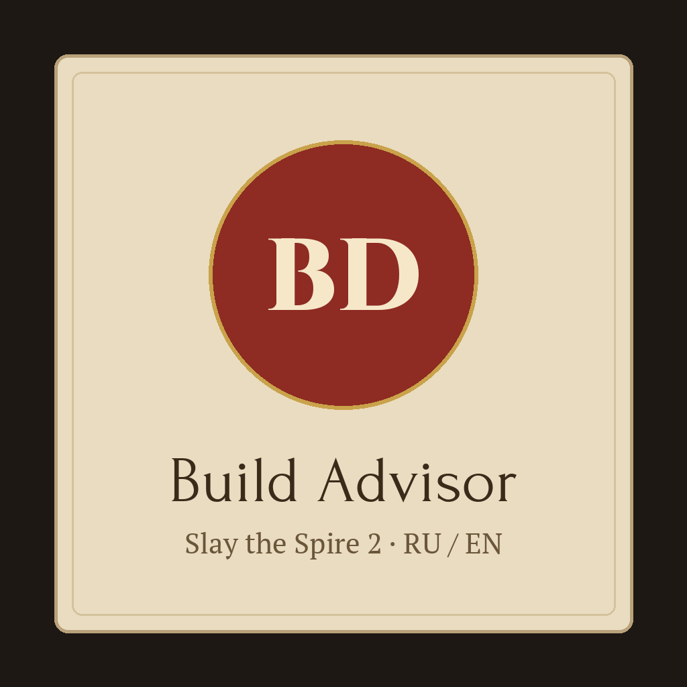
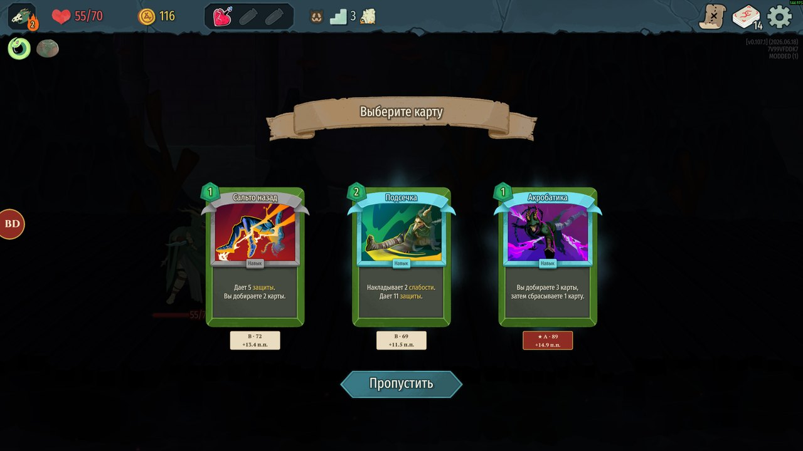
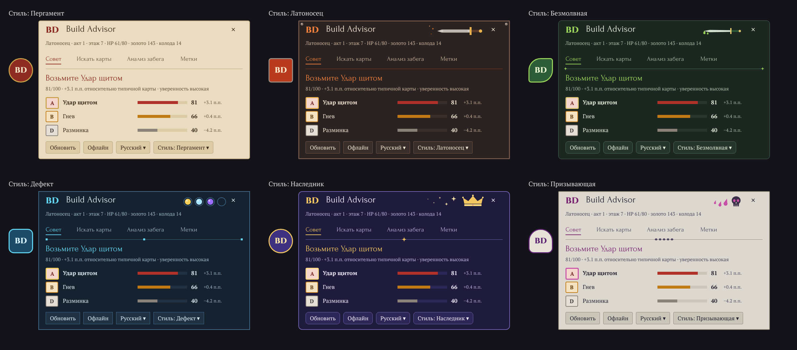

# Build Advisor 7.6.1 for Slay the Spire 2

[Русская версия](README_RU.md) · [Changelog](CHANGELOG.md) · [Install](INSTALL_EN.md) · [Releases](https://github.com/Tkachov0Vitalii/Build_advisor/releases) · [Steam Workshop](https://steamcommunity.com/sharedfiles/filedetails/?id=3832174623) · [Nexus Mods](https://www.nexusmods.com/slaythespire2/mods/1588)



An in-game deck-building advisor. It rates every card reward, shop item, relic choice, campfire upgrade and event option **against your current deck** and explains why — in Russian or English.



## Features

- **Card rewards** — a ribbon under each card: tier S–D, score 0–100 and the distance to the take threshold in win-rate points (above 0 — take); the **Skip** button gets its own ribbon (★ when skipping is the advice). Hover a ribbon for the full breakdown (community base, every deck adjustment, the result).
- **Interface styles** — pick the look in the panel footer: the standard *Parchment* or one per character — *Ironclad* (forged iron, a sword with sparks, rivets), *Silent* (night green, a dagger dripping poison), *Defect* (steel blue, orb slots, a circuit trace), *Regent* (royal indigo, a crown and a twinkling constellation), *Necrobinder* (bone and ash, a skull with glowing eyes and rising souls). The seal button changes shape with the style; the choice is remembered.

  
- **Advice panel** — the wax seal **BD** at the left edge of the screen or **F8**. A verdict on top ("Take Clash" / "Better skip"), ranked options with coloured tiers, deck needs and archetypes, then the detailed breakdown. Tabs: advice, card search, run analysis, tag reference.
- **Shop** — ribbons on cards, relics and the **card removal** service, the best buy and a purchase plan that fits your gold (a high-priority removal is paid first).
- **Campfire and events** — rest or upgrade (and which card), plus the options relics add: Shovel (dig), Girya (lift), Meat Cleaver (cook), Pael's Growth (clone), Pumpkin Candle (kindle), Byrdonis Egg (hatch), co-op mend; rest rewards from Dream Catcher, Tiny Mailbox, Stone Humidifier; the order of all options with Miniature Tent. Upgrade, removal, transform and enchant priorities on the deck grid; community win-rate verdicts on event options, including Ancients.
- **Relics, potions, map** — relic choice ratings, potion advice on the rewards screen, expected damage and HP after each map node with the recommended path.
- **Archetypes** — community winning decks (Spire Codex Pick Coach) or your own manual direction.
- **Co-op** — reads teammates' decks: protect a fragile teammate, empower an attacker, avoid copying a teammate's engine.
- **Run review** at the end of a run, **offline mode**, optional **auto-pick** (off by default): it does what the panel advises — takes the recommended card or skips the reward, and buys the shop plan's basket.

Unless you turn on auto-pick, the mod never acts for you; it does not change the game's rules (`affects_gameplay: false`). Advice is statistics, not a guarantee.

## Where the numbers come from

- Community statistics: [Spire Codex](https://spire-codex.com/) (Codex Score, win-rate lift, archetypes). Network is optional; the last data is cached on disk.
- **Refresh** (7.6.1) no longer changes the card scores: it used to re-score without the “similar winning decks” adjustment that arrives after the first advice.
- **Slippery Bridge** (7.6) is advised by the card at stake, not by statistics: Spire Codex shows a higher win rate for every further “Hold On” only because runs with HP to spare keep holding on, and 7.5 advised holding on until it became lethal. A starter card, a curse or a weak card → “Overcome” (a free removal); a useful card is kept only while at least half of max HP remains, the next random card is weaker on average and the price is at most 5 HP (8 HP for a key card).
- **Draw cards in act 1** (7.6) no longer get the “needs draw” bonus: on 174k v0.111.x runs a draw card taken in act 1 won no more often than its lift predicts, and where the bonus lifted it above the community favourite the pick had about 1 pp less lift.
- **Statistics of your game version** (7.5): the mod reads the game version and asks Spire Codex for that version only (e.g. `a10:v0.111.0` for game v0.111.1, the beta with the same content), falling back to the previous version of the same patch line or to all versions. After Major Update #3 this matters: Demon Form was −5.1 pp on v0.107.1 and +9.5 pp on v0.111.0. The card panel names the version in use.
- Deck adjustments (needs, archetype fit, copies, deck size, act, upgrades) are weighted by a calibration on **177,251 runs / 1.6 million card rewards**, checked on held-out runs: where the old and the new scoring disagree, runs that took the new pick won 35.2 % vs 33.4 % (test) and 33.5 % vs 29.7 % (validation). Report: [`docs/h3-calibration-report.json`](docs/h3-calibration-report.json).
- **Take or skip**: the number on a ribbon is the distance to the take threshold in percentage points of win rate — above 0 take, below 0 skip. Community lift is a correlation (the average card shows +7 pp), so lifts are read relative to the middle of the character's own cards in the statistics in use (brackets differ: A10 lifts are lower and wider), and the threshold for each act and deck size is set so that skipping is advised as often as winning runs skip there — refitted in 7.5 on 1.6 million rewards of game v0.111.x — act 1: 24 % (winners 24 %), act 2: 41 % (winners 42 %), act 3: 55 % (winners 55 %) on held-out runs. A high learned skip probability raises the threshold. Report: [`docs/take-skip-calibration-report.json`](docs/take-skip-calibration-report.json).
- **Ancient relics** (7.4, refitted in 7.5) are valued at the moment of choice: the win rate of runs that took the relic minus the average Ancient pick of the same character at the same act, on 174k runs of game v0.111.x (all those runs reached that point, so survival does not inflate late picks). Held-out check: per-relic values correlate 0.89 with the training ones; runs whose pick was in the top third won 7.9 pp more often than the bottom third. Report: [`docs/ancient-relics-report.json`](docs/ancient-relics-report.json).
- **Relic × card synergies** (7.4) are used only when they hold on held-out runs. On game v0.111.x runs (7.5, 150 pairs named by relic texts) two pass with a mechanical reason: Mummified Hand makes Powers worth about +2.3 pp, Red Mask makes Weak cards worth about −2.8 pp. Game Piece × Powers (7.4, mixed builds) did not hold on v0.111.x and was dropped; the classic ones (Shuriken, Kunai, Pen Nib with Attacks, Letter Opener with Skills) did not hold either. Report: [`docs/relic-synergies-report.json`](docs/relic-synergies-report.json).

## Install

- **[Steam Workshop](https://steamcommunity.com/sharedfiles/filedetails/?id=3832174623)** — subscribe to Build Advisor, start the game, choose *Modded*.
- **Manual ([GitHub Releases](https://github.com/Tkachov0Vitalii/Build_advisor/releases) / [Nexus Mods](https://www.nexusmods.com/slaythespire2/mods/1588))** — extract `BuildAdvisor-7.6.1.zip` into `Slay the Spire 2/mods/` (you get `mods/build-advisor/build-advisor.dll`); start the game and choose *Modded*. Details: [INSTALL_EN.md](INSTALL_EN.md).

The game log (`%APPDATA%\SlayTheSpire2\logs\godot.log`) shows `Build Advisor 7.6.1 loaded; all patches installed; regression matrix passed.`

## Build from source

Requires .NET 9 SDK and the game's assemblies (`sts2.dll`, `GodotSharp.dll`, `0Harmony.dll`) from `data_sts2_windows_x86_64`; they are referenced only and never committed.

```powershell
dotnet build BuildAdvisor.csproj -c Release                          # finds the game in the default Steam folder
dotnet run --project tools/RegressionRunner -c Release               # offline regression matrix: Regression=True
powershell -ExecutionPolicy Bypass -File tools\make_release.ps1      # release ZIP, Workshop workspace, SHA256SUMS
```

Architecture and rules for contributors: [CONTRIBUTING.md](CONTRIBUTING.md), [docs/DEVELOPMENT.md](docs/DEVELOPMENT.md), [CLAUDE.md](CLAUDE.md). Publishing: [publish/README.md](publish/README.md).

## License

MIT — see [LICENSE](LICENSE). Bundled fonts (PT Serif, Forum, Cinzel) are under the SIL Open Font License; see [THIRD_PARTY_NOTICES.md](THIRD_PARTY_NOTICES.md). Not affiliated with Mega Crit.
