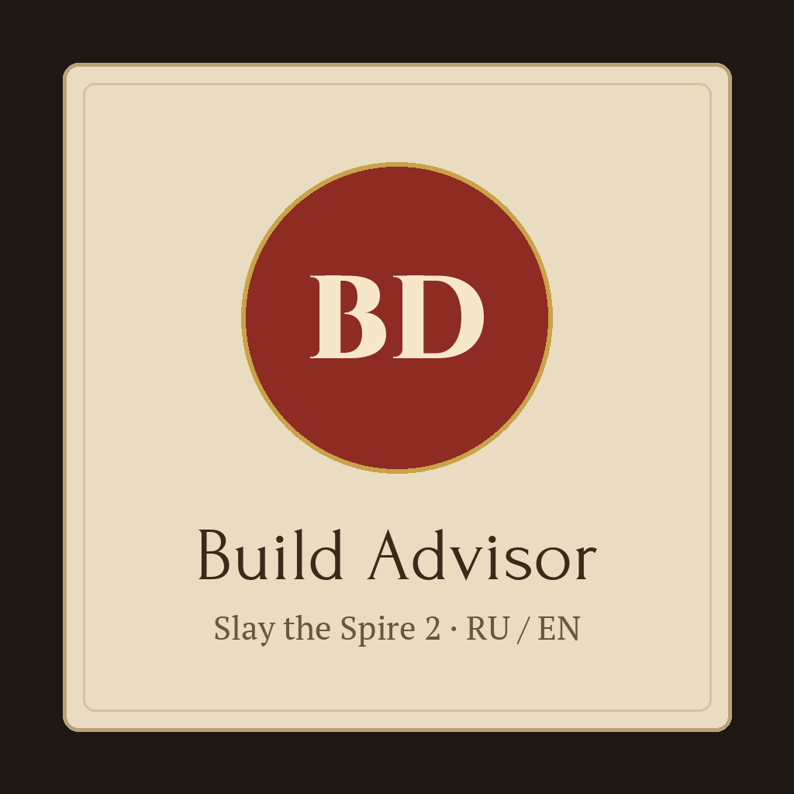
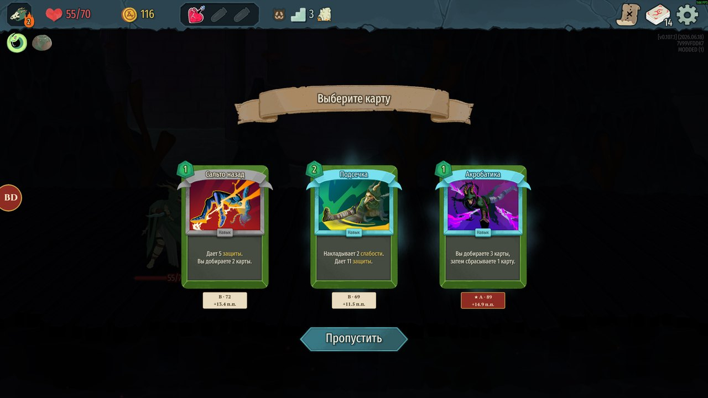

# Build Advisor 7.0.0 for Slay the Spire 2

[Русская версия](README_RU.md) · [Changelog](CHANGELOG.md) · [Install](INSTALL_EN.md) · [Releases](https://github.com/Tkachov0Vitalii/Build_advisor/releases)



An in-game deck-building advisor. It rates every card reward, shop item, relic choice, campfire upgrade and event option **against your current deck** and explains why — in Russian or English.



## Features

- **Card rewards** — a ribbon under each card: tier S–D, score 0–100 and the expected change of the win rate against skipping. Hover a ribbon for the full breakdown (community base, every deck adjustment, the result).
- **Advice panel** — the wax seal **BD** at the left edge of the screen or **F8**. A verdict on top ("Take Clash" / "Better skip"), ranked options with coloured tiers, deck needs and archetypes, then the detailed breakdown. Tabs: advice, card search, run analysis, tag reference.
- **Shop** — ribbons on cards and relics, the best buy and a purchase plan that fits your gold.
- **Campfire and events** — upgrade, removal, transform and enchant priorities on the deck grid; community win-rate verdicts on event options, including Ancients.
- **Relics, potions, map** — relic choice ratings, potion advice on the rewards screen, expected damage and HP after each map node with the recommended path.
- **Archetypes** — community winning decks (Spire Codex Pick Coach) or your own manual direction.
- **Co-op** — reads teammates' decks: protect a fragile teammate, empower an attacker, avoid copying a teammate's engine.
- **Run review** at the end of a run, **offline mode**, optional **auto-pick** (off by default).

The mod never plays for you and does not change the game's rules (`affects_gameplay: false`). Advice is statistics, not a guarantee.

## Where the numbers come from

- Community statistics: [Spire Codex](https://spire-codex.com/) (Codex Score, win-rate lift, archetypes). Network is optional; the last data is cached on disk.
- Deck adjustments (needs, archetype fit, copies, deck size, act, upgrades) are weighted by a calibration on **177,251 runs / 1.6 million card rewards**, checked on held-out runs: where the old and the new scoring disagree, runs that took the new pick won 35.2 % vs 33.4 % (test) and 33.5 % vs 29.7 % (validation). Report: [`docs/h3-calibration-report.json`](docs/h3-calibration-report.json).

## Install

- **Steam Workshop** — subscribe to Build Advisor, start the game, choose *Modded*.
- **Manual (GitHub Releases / Nexus Mods)** — extract `BuildAdvisor-7.0.0.zip` into `Slay the Spire 2/mods/build-advisor/` keeping the inner `build-advisor` folder; start the game and choose *Modded*. Details: [INSTALL_EN.md](INSTALL_EN.md).

The game log (`%APPDATA%\SlayTheSpire2\logs\godot.log`) shows `Build Advisor 7.0.0 loaded; all patches installed; regression matrix passed.`

## Build from source

Requires .NET 9 SDK and the game's assemblies (`sts2.dll`, `GodotSharp.dll`, `0Harmony.dll`) from `data_sts2_windows_x86_64`; they are referenced only and never committed.

```powershell
dotnet build BuildAdvisor.csproj -c Release                          # finds the game in the default Steam folder
dotnet run --project tools/RegressionRunner -c Release               # offline regression matrix: Regression=True
powershell -ExecutionPolicy Bypass -File tools\make_release.ps1      # release ZIP, Workshop workspace, SHA256SUMS
```

Architecture and rules for contributors: [CONTRIBUTING.md](CONTRIBUTING.md), [docs/DEVELOPMENT.md](docs/DEVELOPMENT.md), [CLAUDE.md](CLAUDE.md). Publishing: [publish/README.md](publish/README.md).

## License

MIT — see [LICENSE](LICENSE). Bundled fonts (PT Serif, Forum, Cinzel) are under the SIL Open Font License; see [THIRD_PARTY_NOTICES.md](THIRD_PARTY_NOTICES.md). Not affiliated with Mega Crit.
