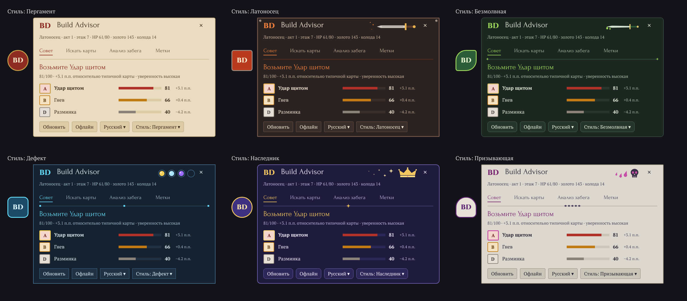

# Build Advisor 7.3.0

## Interface styles

Pick the look in the panel footer ("Style"). The choice is remembered and applies at once.

- **Parchment** — the standard look, unchanged.
- **Ironclad** — forged dark plate, ember accent, a sword with flickering sparks, rivets in the corners, a square brand for the seal.
- **Silent** — night green, a thin dagger dripping poison, blade tips on the rule, a blade-shaped seal.
- **Defect** — steel blue and cyan, four orb slots (lightning, frost, dark pulse; the fourth is empty), a circuit-trace rule.
- **Regent** — royal indigo and gold, a jewelled crown with a twinkling constellation.
- **Necrobinder** — bone and ash, a skull with glowing eyes, rising souls, a bone seal.

Tier colours S–D are the same in every style. Text contrast is checked for each style (body ≥ 7:1).

## Files

| File | Use |
|---|---|
| `BuildAdvisor-7.3.0.zip` | Manual install: extract into `Slay the Spire 2/mods/` |
| `BuildAdvisor-7.3.0-workshop.zip` | Steam Workshop workspace for the Mega Crit uploader |
| `SHA256SUMS.txt` | Checksums |

Get it on [Steam Workshop](https://steamcommunity.com/sharedfiles/filedetails/?id=3832174623) or [Nexus Mods](https://www.nexusmods.com/slaythespire2/mods/1588). Full history: [CHANGELOG.md](../../CHANGELOG.md) (Russian).
