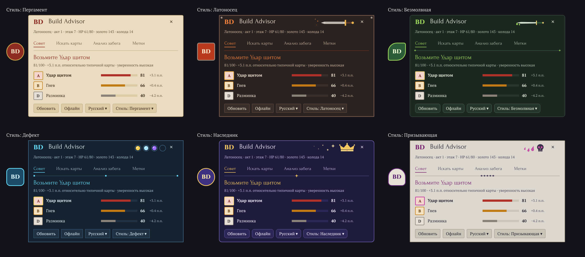

# Build Advisor 7.3.1

## Fix: at high ascensions nearly every card was below the threshold

- The 7.2 threshold was fitted on the general statistics, but at ascension 10 the mod uses the A10 bracket, where lifts are lower (median +7.2 instead of +9.1 pp) and wider, and the characters' own cards differ a lot. B–S cards showed negative numbers and act 1 could pass without one "take".
- Lifts are now read relative to the middle of the character's own cards in the statistics in use, on one spread, so the verdict does not depend on the bracket.
- The threshold is set for each act and deck size so that skipping is advised as often as winning runs skip there: act 1: 23 % (winners 23 %), act 2: 40 % (winners 40 %), act 3: 53 % (winners 54 %) on held-out runs.
- The number on ribbons is the distance to the take threshold: above 0 — take, below 0 — skip.

Also in this build (7.3.0): **interface styles** — Parchment and one per character (Ironclad, Silent, Defect, Regent, Necrobinder), chosen in the panel footer.

## Files

| File | Use |
|---|---|
| `BuildAdvisor-7.3.1.zip` | Manual install: extract into `Slay the Spire 2/mods/` |
| `BuildAdvisor-7.3.1-workshop.zip` | Steam Workshop workspace for the Mega Crit uploader |
| `SHA256SUMS.txt` | Checksums |

Get it on [Steam Workshop](https://steamcommunity.com/sharedfiles/filedetails/?id=3832174623) or [Nexus Mods](https://www.nexusmods.com/slaythespire2/mods/1588). Full history: [CHANGELOG.md](../../CHANGELOG.md) (Russian).
